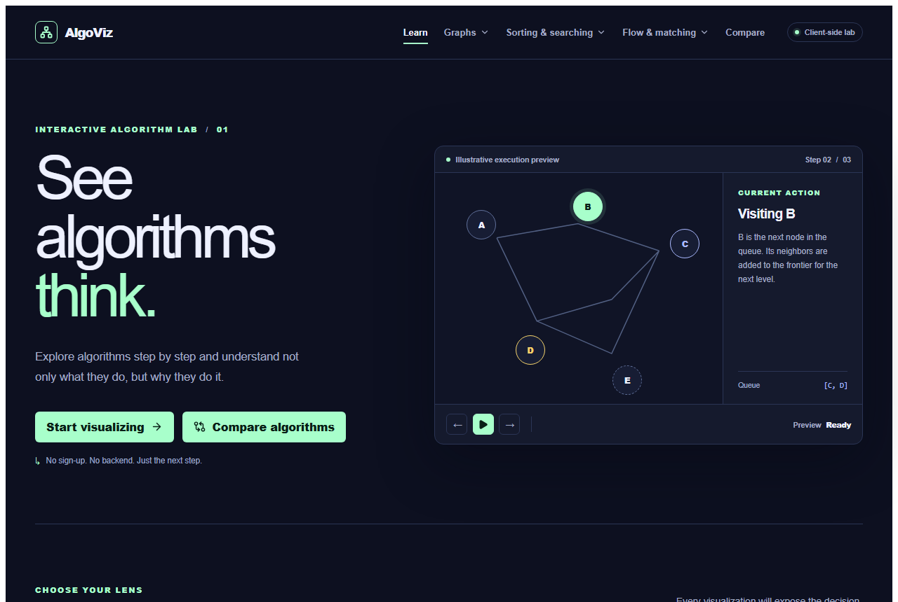
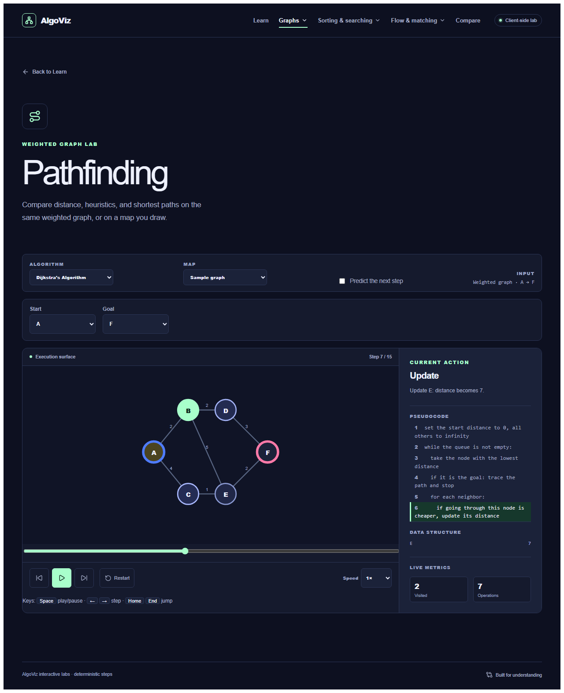
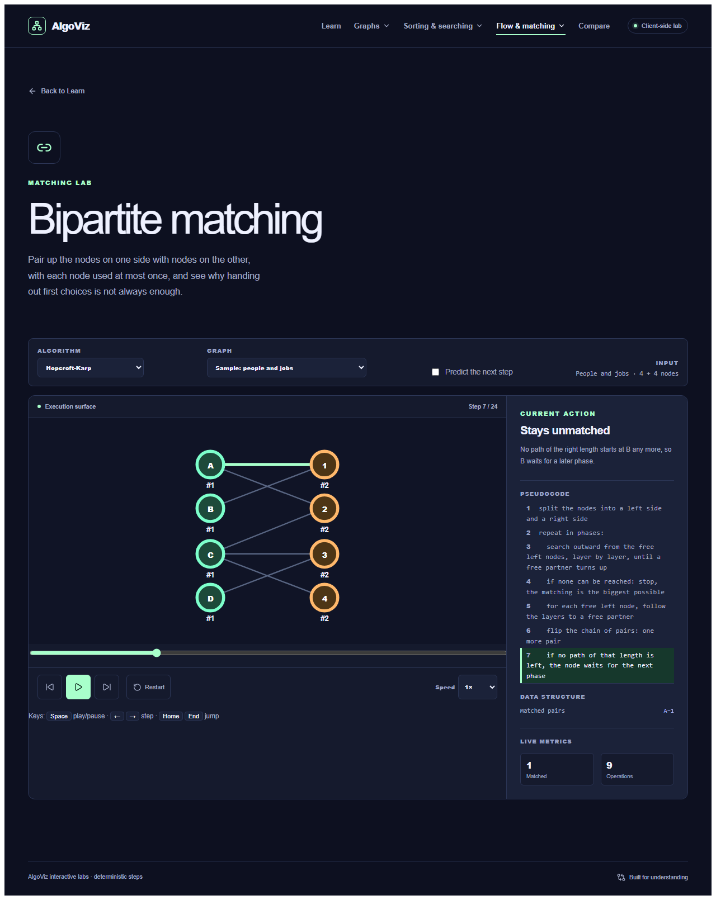
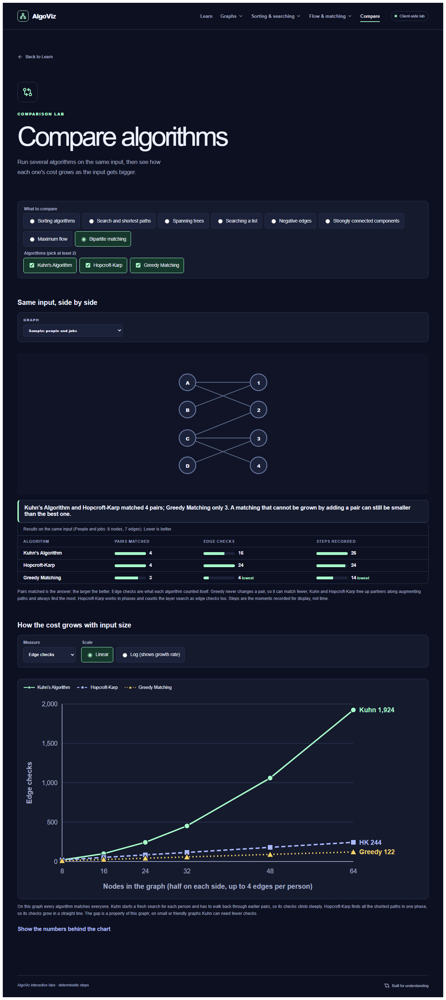

# AlgoViz

An interactive lab that runs 30 algorithms one step at a time. Every step comes with a plain-language explanation, a highlighted line of pseudocode, the data structure behind it, and live metrics. It runs entirely in the browser: no backend, no accounts.

**Live:** https://algoviz-brown-kappa.vercel.app



## What is in it

| Area | Algorithms |
| --- | --- |
| Graph search | BFS, DFS, Bidirectional BFS, Greedy Best-First |
| Shortest paths | Dijkstra, A*, Bellman-Ford (detects negative cycles), Floyd-Warshall |
| Spanning trees | Kruskal, Prim |
| Sorting | Bubble, Selection, Insertion, Shell, Merge, Quick, Heap, Counting, Radix |
| Searching a list | Binary, Linear |
| Ordering | Topological sort (Kahn, DFS) with dependency-loop detection |
| Components | Strongly connected components (Tarjan, Kosaraju) |
| Flow | Max flow (Edmonds-Karp, Ford-Fulkerson) with the min cut shown |
| Matching | Bipartite matching (Kuhn, Hopcroft-Karp, Greedy) |

| Pathfinding | Matching |
| --- | --- |
|  |  |

### Features

- **Playback you can scrub:** step bar, speed, and keyboard shortcuts (Space, arrow keys, Home, End).
- **Your own input:** type numbers for sorting, draw a grid map with walls and heavy ground, or edit a graph by dragging nodes and adding edges. It all lives in the URL, so a link shares your exact setup.
- **Predict the next step:** a quiz mode whose questions and answers are computed from the recorded run, with a score.
- **Compare:** run several algorithms on the same input and get a table of measured counts, a summary sentence, and a growth chart over input size on a linear or log scale. Every number comes from an actual run.
- **Accessible:** labelled controls, data-table fallbacks for charts, colour is never the only signal, and axe-core reports no violations at 1280 px or 375 px.



## How it is built

The main design choice is to keep **algorithms and drawing apart**. An algorithm never touches the screen. It returns a list of immutable steps (`AlgorithmExecution`), and the visualizer replays them. That makes every algorithm testable on its own and lets the same recording drive the canvas, the pseudocode highlight, the predict quiz, and the Compare benchmarks.

```
src/algorithms/<family>/   pure engines, no React
src/algorithms/shared/     step contract, sample graphs, pseudocode, benchmark, predict
src/algoviz/               React pages, components, styles
```

### Testing

375 tests (Vitest, jsdom, Testing Library). Engine tests do not just check examples: they compare results against independent oracles on random inputs, for example A* against Dijkstra, Bellman-Ford against Floyd-Warshall, Kruskal against Prim, SCCs against reachability, max flow against a brute-force min cut, and bipartite matching against a max-flow network.

### Stack

React 19, TypeScript, Vite, React Router 7, Zustand, Vitest. Deployed on Vercel from `main`.

## Run it locally

Requires Node.js 22 or later.

```bash
npm ci
npm run dev
```

```bash
npm test
```

```bash
npm run build
```

## Limits

- Graphs in the editor have at most 12 nodes, and typed sort input at most 24 numbers.
- "Steps" in Compare are the moments recorded for display, not running time.
- A*, BFS, DFS and Greedy are left out of the negative-edge lab because they do not support negative weights.
